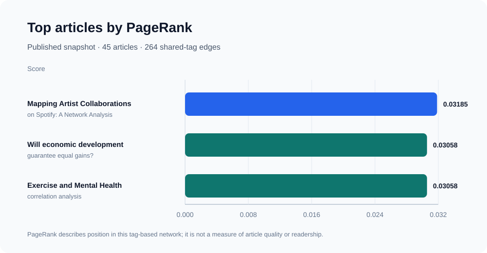

# Medium Publication Article Network Analysis

A reproducible Python project that collects public Medium RSS metadata and models thematic overlap across the INST414: Data Science & Tech publication as a weighted article network.

[Published analysis](https://medium.com/inst414-data-science-tech/finding-the-structural-hubs-of-inst414-a-network-analysis-of-course-publications-1b9f7c3cb4e7) · [Source code](https://github.com/Lin0359/medium-publication-network-analysis)

## Published snapshot

The report analyzed a point-in-time snapshot of **45 articles** and **264 shared-tag edges**. The figure below summarizes the three highest PageRank scores reported in that analysis. It is a historical result; a new RSS collection can produce different articles, edges, and rankings.

PageRank here describes structural position in a tag-based network. It does not measure article quality, readership, or causal influence. The relationship between articles is based on author-assigned Medium tags, not full-text semantic similarity.

## Data source and method

- **Source:** public RSS metadata from the INST414 Medium publication. The project does not use a Kaggle dataset or a separate API.
- **Fields:** title, canonical article URL, publication date, author, tags, and feed source.
- **Nodes:** one per unique article in the target publication.
- **Edges:** two articles are connected when they share one or more tags; edge weight is the number of shared tags.
- **Measures:** PageRank, degree, weighted degree, and betweenness. Betweenness uses distance = 1 / shared_tag_count, so stronger tag overlap is treated as a shorter path.

The source snapshot is not committed. RSS availability and article metadata can change, so outputs depend on the collection date. The collector saves dated CSV and JSON snapshots to make each local run traceable.

## What the workflow produces

- A network visualization and a tag-frequency chart.
- Top-10 CSV rankings for each centrality measure.
- A JSON summary with article, edge, and tag counts.
- A dated CSV and JSON file for the collected RSS metadata.

## Project files

| File | Purpose |
| --- | --- |
| pachong.py | Collects RSS metadata and writes timestamped CSV and JSON snapshots. |
| analysis.py | Validates the input schema, builds the weighted graph, calculates metrics, and exports charts and rankings. |
| requirements.txt | Lists Python dependencies. |
| .gitignore | Excludes local data, generated results, and virtual environments. |
| assets/pagerank_snapshot.svg | Static chart of the top PageRank scores reported in the published analysis. |

## Setup

Requires Python 3.10 or newer.

~~~bash
python -m venv .venv
# macOS / Linux
source .venv/bin/activate
# Windows PowerShell
.venv\Scripts\Activate.ps1
python -m pip install -r requirements.txt
~~~

## Run the workflow

Collect up to 100 unique articles into data/:

~~~bash
python pachong.py --target 100 --output-dir data
~~~

Use the timestamped CSV path printed by the collector:

~~~bash
python analysis.py --input data/medium_articles_YYYYMMDDTHHMMSSZ.csv --output-dir outputs
~~~

Replace the example timestamp with the filename from your run. The analysis can also read an existing CSV with columns title, link, pubDate, author, tags, and source. The tags field uses a vertical bar (|) between tag names.

### Collector options

- --target: maximum number of unique records (default: 100).
- --delay: delay between feed requests in seconds (default: 1).
- --retries: retry count for rate limits and temporary server errors (default: 4).
- --output-dir: directory for collected CSV and JSON files (default: data).

### Generated outputs

- top_10_pagerank.csv
- top_10_degree.csv
- top_10_weighted_degree.csv
- top_10_betweenness.csv
- article_similarity_network.png
- top_tags.png
- summary.json

Generated files and local data are excluded from version control. Re-run the workflow to create charts for a fresh snapshot.
